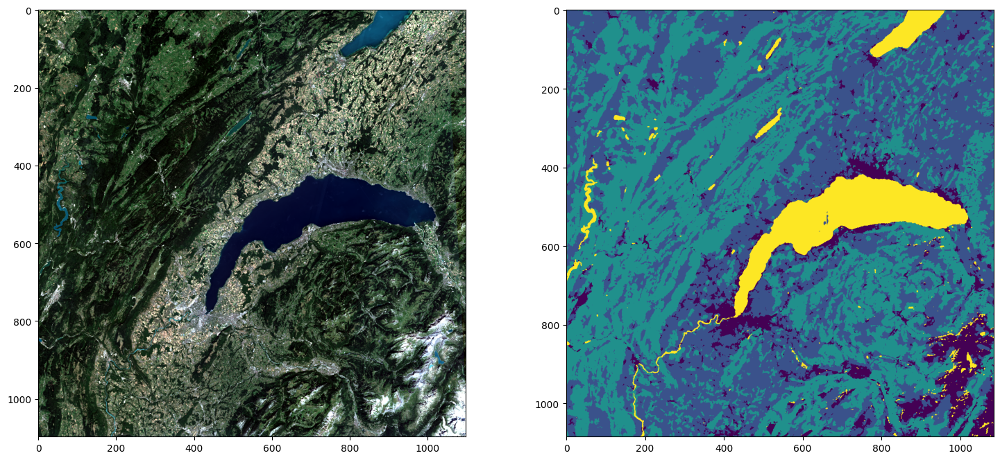

# Implémentation d'un U-Net pour la ségmentation sémantique de classes simples d'occupation du sol à partir d'images Sentinel-2
Ce dépôt présente un notebook jupyter contenant la préparation d'un jeu de données et d'un dataset pytorch à partir d'images S2 et de labels issus du corine land cover, l'implémenation d'un U-Net à partir de la librairie pytorch, l'entraînement et l'inférence de ce modèle.  

Ce travail a été réalisé par Titouan Courgey et Niels Saura dans le cadre d'un TP conçu par Luc Baudoux.

  
   
  <em>Exemple d'image S2 et de l'inférence du modèle sur le lac de Lausanne</em>

